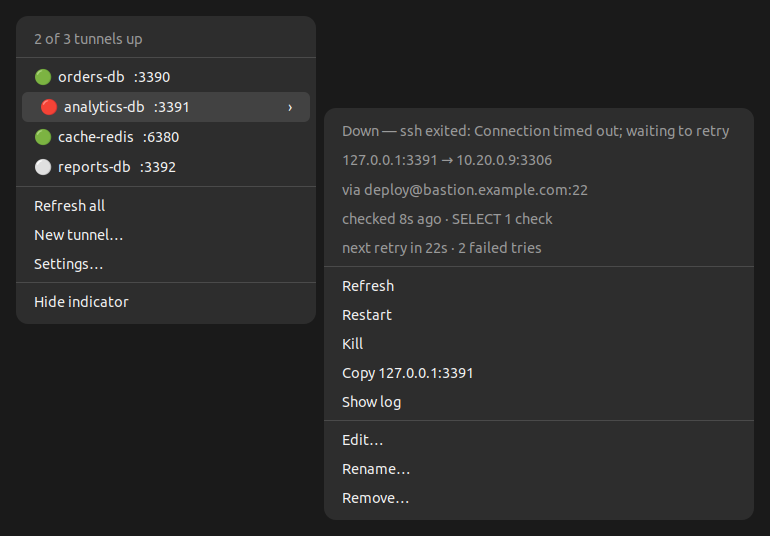
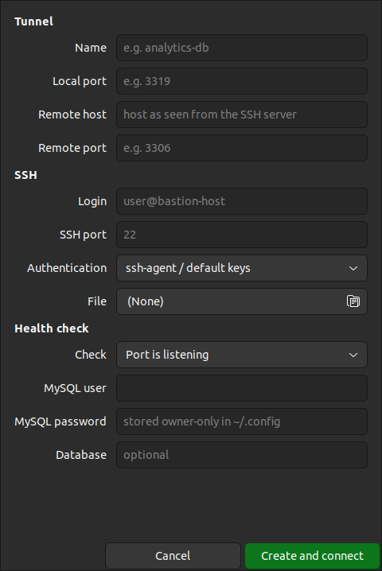
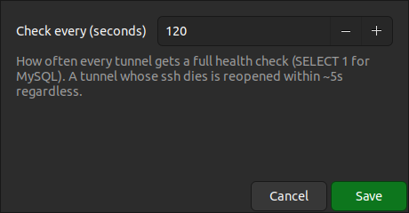
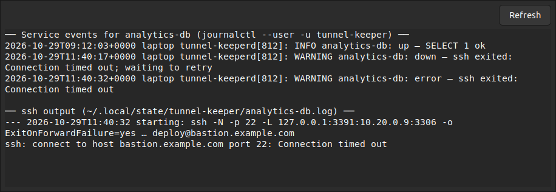

# SSH Tunnel Manager (tunnel-keeper)

Keep your SSH port-forward tunnels up all the time, from any project, and see
their health in the GNOME top bar next to Wi-Fi and Bluetooth.



- **Always on.** A systemd *user* service starts at login and checks every
  tunnel on a schedule (default every 2 minutes). If a tunnel's ssh process
  dies, it is reopened within about 5 seconds.
- **Green means the whole path works, never just "ssh is running".** A
  tunnel is only green once the far end has answered through it:
  - **MySQL databases** are checked with a real `SELECT 1`, using a
    read-only login.
  - **Any other TCP service** (Redis, HTTP, SSH, …) is checked by asking the
    tunnel's ssh to open `remote_host:remote_port`, and reading its answer:
    opened, refused, or no answer within 10 seconds.

  A listening local port proves nothing on its own. ssh keeps accepting
  local connections even when the bastion cannot reach the target.
- **Safe recovery.** A tunnel is restarted only after 3 failed checks in a
  row. If MySQL itself answers with an error (access denied, too many
  connections), the tunnel is not restarted, because reopening it would not
  help. Failed reopens back off 15s → 30s → … up to the check interval.
- **Top-bar panel.**
  - Create, edit, duplicate, rename, kill, start, restart, refresh and remove tunnels.
  - Copy a tunnel's address and view its log.
  - Change the check interval.

  You never need to open a config file.
- **Scriptable.** `tunnelctl` does all of the above from a terminal. Other
  projects can call `tunnelctl ensure --port N` instead of opening their own
  tunnel.

## Install (Ubuntu 22.04+ / GNOME)

Download `tunnel-keeper_<version>_all.deb` from the
[Releases](../../releases) page, or build it yourself (see *Build* below). Then:

```bash
sudo apt install ./tunnel-keeper_*_all.deb
systemctl --user daemon-reload
systemctl --user start tunnel-keeper     # starts by itself at every later login
tunnel-keeper-indicator &                # starts by itself at every later login
```

`apt` pulls in the dependencies: `python3-gi`, GTK 3,
`gir1.2-ayatanaappindicator3-0.1`, `python3-pymysql` and `openssh-client`.
`sshpass` is recommended. The icon shows up through the *Ubuntu
AppIndicators* GNOME extension, which Ubuntu enables by default.

**Upgrade:** install the new `.deb` the same way, then:

```bash
systemctl --user daemon-reload && systemctl --user restart tunnel-keeper
pkill -f tunnel-keeper-indicator; tunnel-keeper-indicator &
```

**Uninstall:** `sudo apt remove tunnel-keeper`. Your tunnels stay in
`~/.config/tunnel-keeper/`.

## Use it from the top bar

The icon is green when all tunnels are up, amber when some are down, red when
none are up, and grey when the service is not running.

| New tunnel / Edit | Settings |
|---|---|
|  |  |

- **New tunnel…** asks for:
  - a name and a local port
  - the remote host and port, as seen from the SSH server
  - the SSH login (`user@host`) and port
  - how to authenticate: ssh-agent or default keys, a key file, or a password file
  - **what's behind it:** a MySQL database (checked with `SELECT 1`, which
    needs a login) or any other TCP service (checked for reachability, no
    login needed)
- **Edit…** opens the same form, pre-filled. Change the name there to rename
  the tunnel. Leave the MySQL password blank to keep the current one.
- **Duplicate…** opens the New-tunnel form pre-filled from that tunnel, with
  a new name (`<name>-copy`) and the next free local port. Change what
  differs, such as the remote host, and create it. Leave the MySQL password
  blank to reuse the original's: the copy gets its own copy of it, so
  removing the original never breaks the duplicate.
- **Kill** closes the tunnel and keeps it down until you **Start** it again.
- **Show log** shows the service's events for that tunnel and ssh's own output:



## Use it from a terminal

```bash
tunnelctl status                       # every tunnel, its state and last check
tunnelctl add orders-db --ssh deploy@bastion.example.com --local-port 3390 \
    --remote 10.20.0.7:3306 --mysql-user readonly --mysql-password-file ~/.secrets/orders
tunnelctl add cache-redis --ssh deploy@bastion.example.com --local-port 6380 \
    --remote 10.20.1.4:6379             # no --mysql-user: reachability check
tunnelctl refresh [NAME]               # check now, reopen anything down
tunnelctl stop NAME | start NAME | restart NAME | remove NAME
tunnelctl rename OLD NEW
tunnelctl interval [SECONDS]           # show or set the full-check interval (30–3600)
tunnelctl logs NAME                    # service events + ssh output
tunnelctl ensure --port 3390           # for scripts, see below
```

```text
$ tunnelctl status
● orders-db     up       :3390  → 10.20.0.7:3306           checked 42s ago
                SELECT 1 ok
✕ cache-redis   error    :6380  → 10.20.1.4:6379           checked 8s ago
                bastion could not connect to 10.20.1.4:6379: connection refused
◌ reports-db    stopped  :3392  → 10.20.0.11:3306          checked 10m ago
                stopped
```

### Import a tunnel from a project's `.env`

If a project already describes its tunnel in `.env` / `.env.local`, for
example `DB_TUNNEL_HOST`, `DB_TUNNEL_REMOTE_PORT` and `MYSQL_USER`:

```bash
tunnelctl import-env ~/code/my-project --name orders-db --prefix DB_TUNNEL --mysql-prefix MYSQL
```

For prefix `P` it reads:

- `P_SSH_HOST` (or `P_BASTION_HOST`, `P_HOST`)
- `P_SSH_PORT` (or `P_BASTION_PORT`)
- `P_SSH_USER` (or `P_BASTION_USER`)
- `P_SSH_KEY` or `P_PASSWORD_FILE`
- `P_REMOTE_HOST`, `P_REMOTE_PORT`
- `P_LOCAL_PORT`

`--fallback-prefix` borrows missing SSH settings from a second prefix.

### Let other scripts reuse the tunnel

`tunnelctl ensure --port N` exits with:

| Exit code | Meaning |
|---|---|
| `0` | healthy |
| `1` | managed here but unhealthy or stopped |
| `2` | not managed here |
| `3` | service not running |

If a tunnel was checked as healthy in the last 30 seconds, `ensure` answers
instantly. A script that opens its own tunnel can defer to the service:

```bash
if command -v tunnelctl >/dev/null; then
  rc=0; tunnelctl ensure --port "$LOCAL_PORT" --quiet || rc=$?
  case $rc in 0) exit 0 ;; 1) echo "tunnel unhealthy: tunnelctl status" >&2; exit 1 ;; esac
fi
# 2/3: not managed or service down: open the tunnel the old way
```

## What the colours mean

| Dot | Meaning |
|---|---|
| 🟢 up | the far end answered through the tunnel at the last check (see "checked … ago") |
| 🔴 down / error | ssh is not running, or it is but the far end did not answer; the reason is shown, e.g. `no answer from 10.20.0.9:3306 within 10s (unreachable or filtered from the bastion)` |
| 🟠 conflict | another program holds the local port |
| ⚪ stopped | you killed it; it stays down until you start it |

**MySQL and the reachability check.** Do not use the reachability check for a
MySQL server. Each check opens and drops a connection without logging in.
MySQL counts those, and after `max_connect_errors` of them in a row (100 by
default) it blocks the connecting host, which is the bastion, so it blocks
everyone using it. The form and `tunnelctl add` warn when the remote port
looks like MySQL (3306–3310).

## How it works

```
tunnel-keeper.service (systemd --user)
 ├─ check loop: every 5s "did an ssh die?", every N s a full health check per tunnel
 ├─ one ssh -N -L 127.0.0.1:LOCAL:REMOTE per tunnel, run as child processes
 └─ control socket $XDG_RUNTIME_DIR/tunnel-keeper.sock (owner-only, JSON lines)
        ▲                      ▲
   tunnelctl          tunnel-keeper-indicator (GTK 3 + AppIndicator)
```

- **How the reachability check reaches the far end.** Each ssh the service
  starts is also an ssh ControlMaster, so the check runs over the tunnel's
  own session (`ssh -S … -W host:port`) without logging in again.
- **Adopting existing tunnels.** If a tunnel for the same forward was already
  opened by something else, such as a project script, it is *adopted* when
  healthy and replaced when not. An adopted tunnel has no control socket, so
  its reachability check logs in separately.
- **Port conflicts.** If an unrelated program holds the local port, the tunnel
  shows **conflict** and nothing is killed.
- **Where things are stored.**
  - Config: `~/.config/tunnel-keeper/tunnels.json`, mode 0600. Only the
    service writes it.
  - MySQL check passwords: `~/.config/tunnel-keeper/secrets/`, mode 0600.
  - Passwords never appear on a command line. `sshpass -f` and `SSH_ASKPASS`
    only ever receive a file path.
- **Logs.**
  - Service: `journalctl --user -u tunnel-keeper -f`.
  - Each tunnel's ssh output: `~/.local/state/tunnel-keeper/<name>.log`.

## Build and develop

```bash
packaging/build-deb.sh                 # → dist/tunnel-keeper_<version>_all.deb

python3 -m venv --system-site-packages .venv
.venv/bin/pip install pytest pytest-cov pymysql
.venv/bin/python -m pytest --cov       # 160+ tests, ~98% coverage
python3 docs/screenshots/generate.py   # regenerate the README screenshots (demo data)
```

## License

[MIT](LICENSE)
